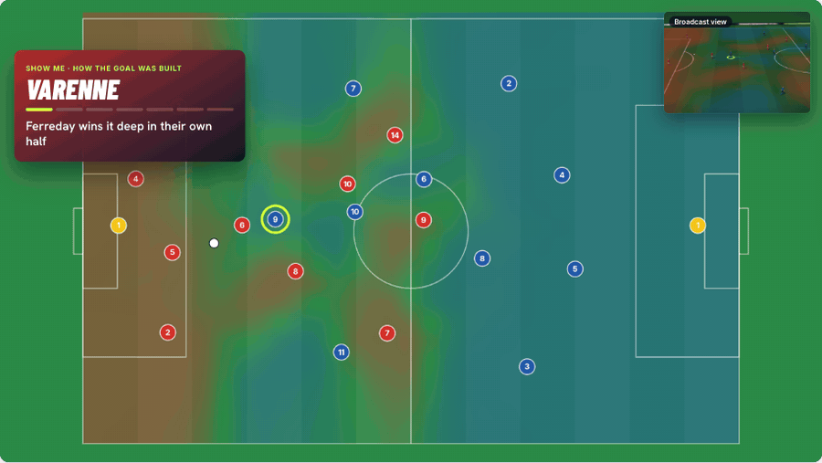
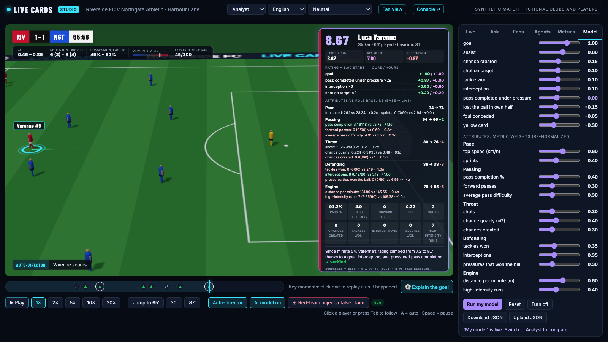
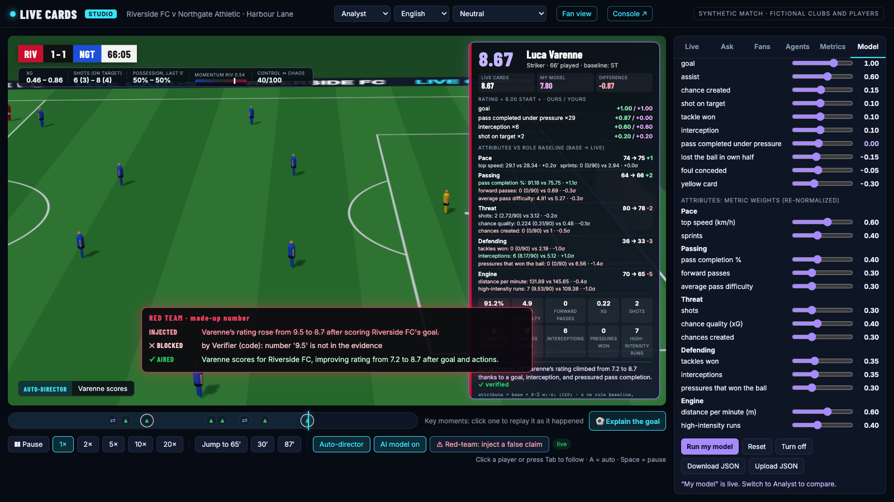
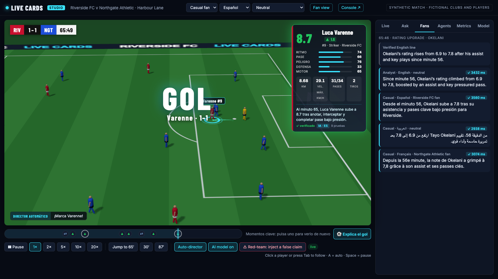
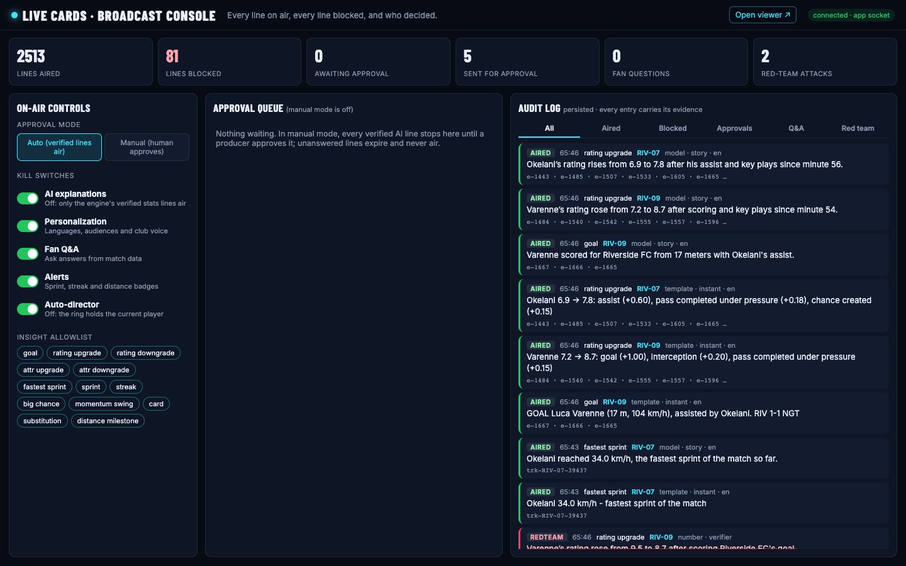
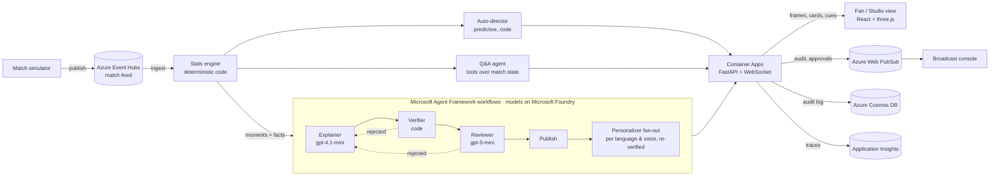

# Live Cards

**Every number explains itself.** A ring follows any player and their live card updates as the
match unfolds. Every change comes with a reason, every reason is checked against the match data
before it airs, and each fan gets it in their own language and depth.



**[Live demo](https://livecards.mangorock-d6a7d3f2.northcentralus.azurecontainerapps.io/?start=3935)** ·
**[Broadcast console](https://livecards.mangorock-d6a7d3f2.northcentralus.azurecontainerapps.io/?view=console)** ·
[Evaluation](docs/evaluation.md) · [Architecture and deployment](docs/deployment.md) · [Design decisions](docs/decisions.md)

> Built for the Microsoft × Premier League *Inside the Game* hackathon, Oct 22–26, 2026.
> **All data is synthetic:** the clubs (Riverside FC, Northgate Athletic), the players, the
> venue and every event come from our own simulator.

---

## What it does

| | |
|---|---|
| **A ring that thinks ahead** | An auto-director follows the story. When a cross is played it moves the ring to the striker *before the ball lands*, and says why: *"Cross incoming: Varenne arriving, xG 0.28 from there."* |
| **Cards that explain themselves** | Ratings and attributes come from published formulas. Each change shows its reason the moment it happens (*"Varenne 7.2 → 8.7: goal +1.00, interception +0.20…"*), then an AI-written line replaces it once it passes two checks. |
| **Nothing unverified airs** | A code verifier checks every number, name and superlative; a reasoning model checks every claimed event. Planted lies: **0 of 275 aired** ([evaluation](docs/evaluation.md)). A red-team button plants one live. |
| **Two genuinely different experiences** | *Casual:* the story, in English, Spanish, French, Portuguese or Arabic, in a neutral or home/away fan voice. *Analyst:* the rating ledger, each attribute's metrics against the role baseline, xG, and a team strip. |
| **Ask, Revisit, Explain this goal** | Fans ask questions and get answers built only from match data, with evidence. A timeline replays any key moment as it was. "Explain the goal" replays the move at half speed while the ring follows each touch. |
| **Your model** | Analysts set their own rating and attribute weights. A second engine runs their formula next to ours and the card compares them line by line. |
| **Built for a broadcaster** | A console with kill switches, an insight allowlist, a human-approval mode, and a permanent audit log of every line aired or blocked. Every on-screen element is also a timed, machine-readable overlay cue ([JSON Schema](docs/overlay-cue.schema.json)) for a graphics partner. |

| Studio view: Analyst mode with "Your model" | Red team: a planted lie, blocked |
|---|---|
|  |  |
| **Spanish viewer, and the same moment for four fans** | **Broadcast console** |
|  |  |

## The brief's pipeline, end to end

| Stage | How Live Cards does it | Where |
|---|---|---|
| **Ingest** | A 90-minute simulation: positions at 10 fps (54,000 frames), plus passes, shots, tackles, interceptions, pressures, fouls, cards, substitutions. It's published to **Azure Event Hubs** and ingested back by the engine. | [`sim/`](backend/livecards/sim), [`feed.py`](backend/livecards/feed.py) |
| **Interpret** | Deterministic code turns events and tracking into stats, a 0–10 rating, five attributes, sprints and alerts, momentum, control vs. chaos, and *moments* scored for importance. **No model ever computes a number.** | [`engine/`](backend/livecards/engine) |
| **Explain** | Agents write *why* a moment matters: the Explainer, a code Verifier, a gpt-5-mini Reviewer, Q&A with tools, and goal build-ups reconstructed from events. | [`agents/`](backend/livecards/agents) |
| **Render** | A three.js broadcast: ring, speed trail, card, ticker, goal banner, build-up replay. The same content is emitted as timed overlay cues. | [`web/`](web/src), [`cues.py`](backend/livecards/server/cues.py) |
| **Personalize** | Casual or analyst, five languages, home/away/neutral voice, and your own rating model. Every variant is re-verified in its language. | [`personalizer.py`](backend/livecards/agents/personalizer.py), [`i18n.ts`](web/src/i18n.ts) |

## Architecture



| Microsoft technology | Used for |
|---|---|
| **Microsoft Foundry** | Hosts gpt-4.1-mini (Explainer, Personalizer, Q&A) and gpt-5-mini (Reviewer); built-in **evaluators** score the agents ([results](docs/evaluation.md)) |
| **Microsoft Agent Framework** | Agents and workflows: explain → verify → review → rewrite → publish with conditional edges; Personalizer **fan-out/fan-in**; tool-calling Q&A; OpenTelemetry spans; `FoundryEvals` |
| **Azure Container Apps** + Container Registry | Hosts the API, the WebSocket streams and the web app |
| **Azure Event Hubs** | The match feed: the simulator publishes, the engine ingests |
| **Azure Web PubSub** | Fans audit entries, approval requests and control changes out to every connected console |
| **Azure Cosmos DB** (serverless) | The audit log: every line aired, blocked or held, with its evidence |
| **Application Insights** | Traces each moment through each agent, model call, Event Hubs read, Cosmos write and Web PubSub send |

`/api/status` on the live site reports which backend is live for each concern. Every Azure
service has a local fallback (in-process feed, SQLite, app socket), so the app runs anywhere.
Identity is keyless in code: a service principal with narrowly scoped roles. See
[docs/deployment.md](docs/deployment.md) for why it isn't a managed identity.

## The agents

| Agent | Job | Model | Fallback when it fails |
|---|---|---|---|
| **Auto-director** | Who the ring follows and why, ten times a second; predicts the receiver of crosses and through balls; holds a player ≥ 6 s unless a chance is imminent | code (by design: a plain function beats an agent here) | nearest player to the ball |
| **Explainer** | One short line per moment, using only the facts it's given | gpt-4.1-mini | the engine's stats line |
| **Verifier** | Every number (digits, decimals, scores, number words, ordinals, percentages; 5 languages), every player name, every superlative must be in the evidence | code | blocks; the Explainer rewrites once with the reason |
| **Reviewer** | Rejects claimed events or details the facts don't support ("a header", "an assist" that didn't happen) | gpt-5-mini, low reasoning effort | **fails closed** after one retry |
| **Personalizer** | The verified line for each fan profile in parallel (audience × language × voice), each re-verified in its language | gpt-4.1-mini | the verified English line |
| **Q&A agent** | Answers fan questions by calling tools over the live match state (card, rating ledger, recent moments, team state, leaders) | gpt-4.1-mini + tools | *"I can't verify that from the match data."* |
| **Red team** | Corrupts the Explainer's first draft on demand, to show the checks working on air | wraps the Explainer | not applicable |

Lines appear in two phases: the engine's stats line airs instantly (it's code, verified in
under a millisecond), then the AI line replaces it only after it passes both checks. The
screen never waits, and nothing unchecked airs.

## Trust, measured

From [docs/evaluation.md](docs/evaluation.md): 330 lines built from real match moments in
English, Spanish and French, with lies planted in 275.

| Case | Code verifier | Reviewer | Both (what airs) |
|---|---|---|---|
| Correct lines allowed | 100% | 91–95% | 91–95% |
| Changed number blocked | 85% | 100% | **100%** |
| Wrong number in words | 100% | 100% | **100%** |
| Wrong player | 100% | 100% | **100%** |
| Unsupported superlative | 100% | 100% | **100%** |
| Invented event (all numbers correct) | 0% | 100% | **100%** |

The two layers cover each other: code can't judge an invented header; a model can miss a
digit. Microsoft Foundry's own evaluators rate the **raw** Explainer 14/15 on groundedness (the
reason nothing raw airs) and the Q&A agent 5/5 on intent resolution, task adherence and
tool-call accuracy. The test suite (148 tests) includes a whole-match mutation test: change any
one number in any engine-written line and the verifier must block it.

## The numbers, and where they come from

**Numbers come from code, words come from agents.** Each formula lives in
[`engine/`](backend/livecards/engine) and is unit-tested. We label what's standard and what's ours:

| Standard in football analytics | Our own design |
|---|---|
| xG concept (ours is a simple logistic on distance and goal-mouth angle, not trained on real shots) | The 0–10 live rating and its event weights |
| Pass completion, tackles, interceptions, pressures, distance, top speed | The five attributes (Pace, Passing, Threat, Defending, Engine) and how they combine metrics |
| Sprint ≥ 25.2 km/h and high-intensity run ≥ 19.8 km/h thresholds | Pass difficulty, momentum, control vs. chaos |

**Live rating (0–10):** starts at 6.0 and moves with each event, capped at 3.0 and 10.0. Every
change is in an auditable ledger with its event id. Event weights: goal +1.0, assist +0.6,
chance created +0.15, shot on target +0.1, tackle or interception won +0.1, pass completed under
pressure +0.03, turnover in own half −0.15, foul −0.05, yellow card −0.3.

**Attributes (1–99):** `base + clamp(round(8 × Σ wᵢ·zᵢ), −20, +20)`, where `zᵢ` compares a
metric with the player's role average. Values are shrunk toward the average early in a match (a
30-minute prior), so one tackle can't swing a card. Role averages are measured on 8 simulated
matches. Pace can only rise during a match (tiredness shows in Engine).

| Attribute | Metrics (weight) |
|---|---|
| Pace | top speed (0.6), sprints (0.4) |
| Passing | completion % (0.4), forward passes (0.3), average pass difficulty (0.3) |
| Threat | shots (0.3), xG (0.4), chances created (0.3) |
| Defending | tackles won (0.35), interceptions (0.35), pressures that won the ball (0.3) |
| Engine | distance per minute (0.6), high-intensity runs (0.4) |

**Pass difficulty (1–10):** `1 + min(4, distance/10) + min(2, progress/15) + 1.5 under pressure
+ 1.0 into the final third + 0.5 for a cross or through ball`.
**xG:** `logistic(−1.1 + 1.6·angle − 0.075·distance)`. The penalty spot is 0.29.

**Upgrades:** the rating rises 0.5+ or an attribute rises 3+ (net) within 10 minutes; once per
rise. **Alerts:** sprint over 32 km/h, fastest sprint of the match, three notable actions in a
row, every 2 km covered.

Disagree with any of it? **Your model** (Studio → Model) lets you change the weights and see
both ratings side by side.

## Measured

Only numbers we measured (details in [docs/decisions.md](docs/decisions.md)):

| | |
|---|---|
| Stats line on screen after a goal | **0.3 ms** to verify; airs with the moment |
| AI line on screen after a goal (cloud) | **3.2–3.3 s**, through Explainer, Verifier and Reviewer; up to ~6 s at busy moments |
| Explainer / Reviewer model call | 0.8–2.3 s / 1.9–3.2 s |
| Full 90-minute simulation | ~1.5 s for 54,000 frames + ~2,300 events |
| Match through Event Hubs | 1,093 messages, 12.4 MB compressed; published in 8.5 s, ingested in 12.9 s |
| Planted lies aired | **0 of 275** |

## Run it

```bash
# backend (Python 3.12, uv)
cd backend && uv sync --extra agents --extra azure
uv run pytest -q                                   # 148 tests
uv run uvicorn livecards.server.app:app --port 8010

# web (Node 22)
cd web && npm install && npm run dev -- --port 5180
# open http://localhost:5180/?start=3935  (just before the 65' goal)
```

Without Azure configured, everything still runs: templates instead of AI lines, a local
feed, SQLite, and the app socket. To use Foundry, follow [docs/azure-setup.md](docs/azure-setup.md)
and fill in `backend/.env`. Deploy with `deploy/redeploy.sh <tag>`. Other scripts:
`scripts/evaluate.py` (safety + Foundry evals), `scripts/calibrate_baselines.py`,
`livecards replay --seed 7 --from 64 --to 68` (terminal replay).

## Limitations, honestly

- **Synthetic data:** the role averages, xG and the storylines (a planted sprint-and-goal, a fading
  midfielder, a late winner) come from our simulator, and every seed ends 2–1 by design. In
  production the engine would read a real tracking and event feed instead.
- **The rating weights come from the brief, not from data.** Routine passes under pressure add
  up (+0.87 for 29 of them), which an analyst will spot. That's why "Your model" exists.
- **The verifier matches numbers, not units:** a wrong number that happens to equal another fact
  can pass the code check (8 of 55 in the evaluation); the reviewer caught all of them.
- **One replica:** the console's control plane and viewer sessions live in memory; scaling out
  would move them to shared state (Redis or Cosmos change feed).
- **Pass difficulty, momentum and control vs. chaos are our own formulas,** not industry standards.

## Repo layout

```
backend/livecards/
  sim/        simulator, fictional roster, planted storylines
  engine/     stats, rating ledger, attributes, moments, build-ups, your-model specs
  agents/     explainer, verifier, reviewer, personalizer, Q&A, director, red team, pipeline
  server/     FastAPI app, live sessions, console control plane, audit log, cues, Web PubSub
  feed.py     Event Hubs publish/ingest      telemetry.py   Application Insights
backend/tests/  148 tests       backend/scripts/  evaluate, calibrate, record GIF, screenshots
web/src/    React + three.js: viewer, overlays, Fan/Studio views, console, i18n
docs/       evaluation, deployment, decisions, pitch, cue schema, media
```

Clubs, players, venue and data are fictional. No league data, logos or branding are used.
