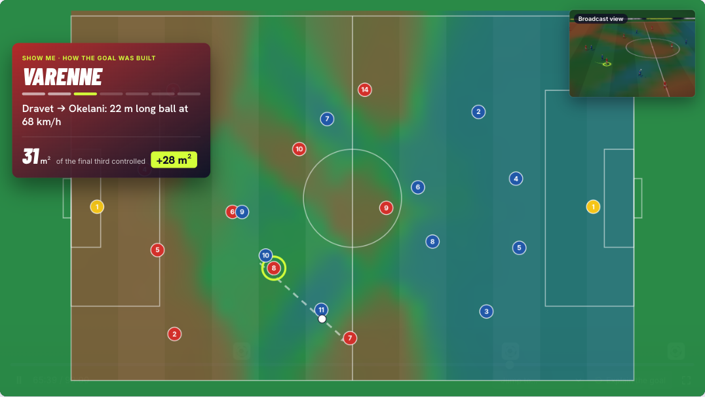
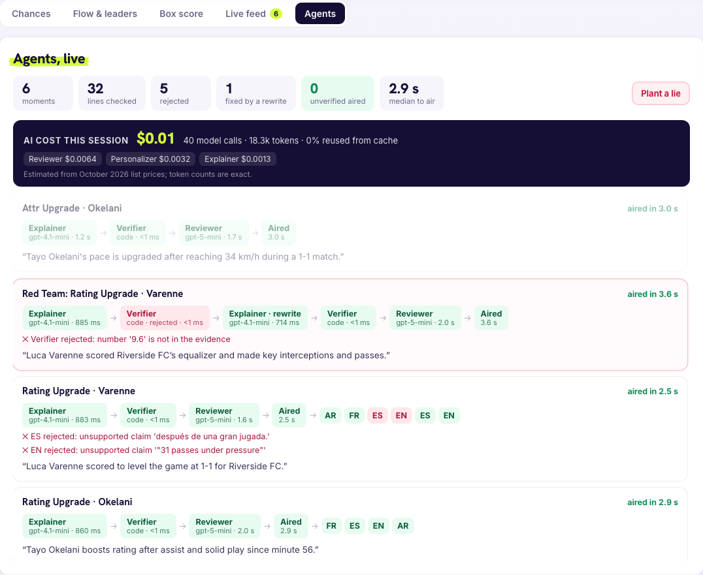
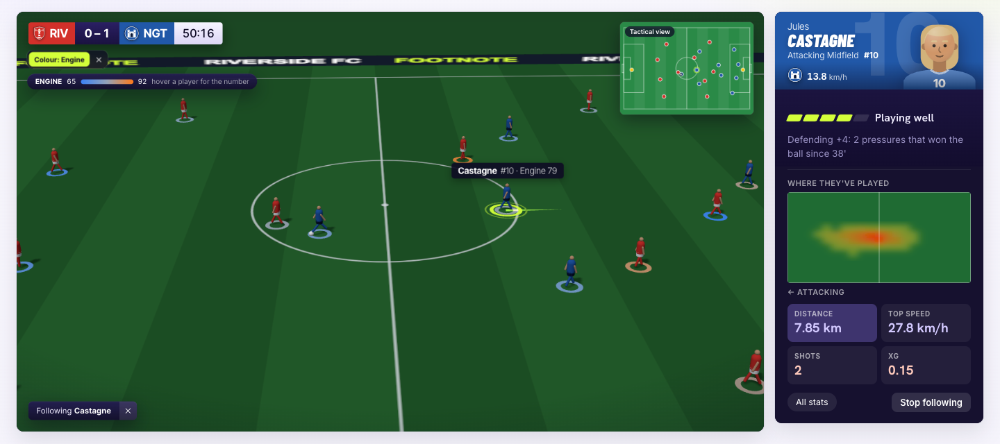
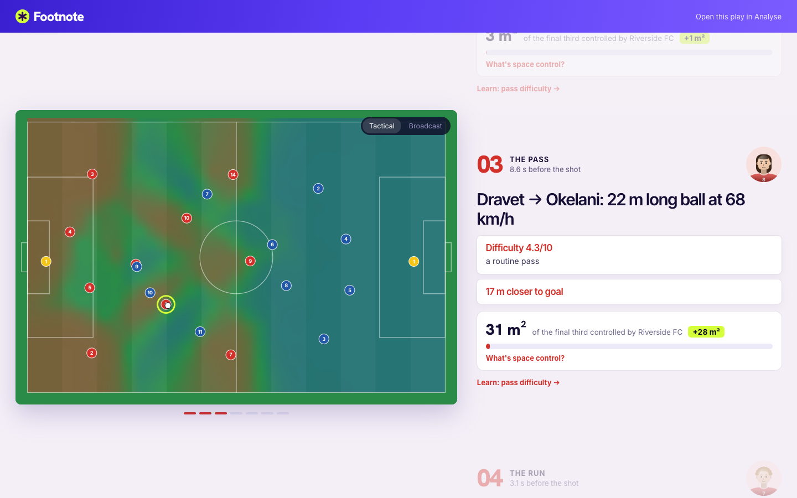
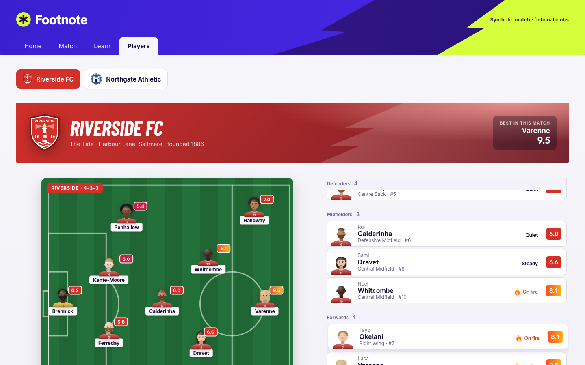
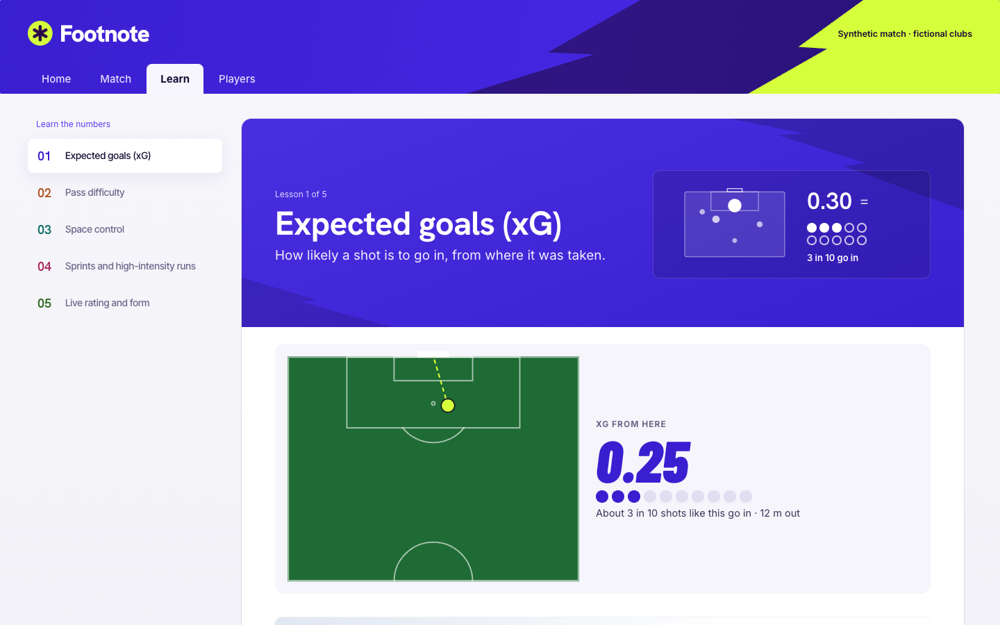
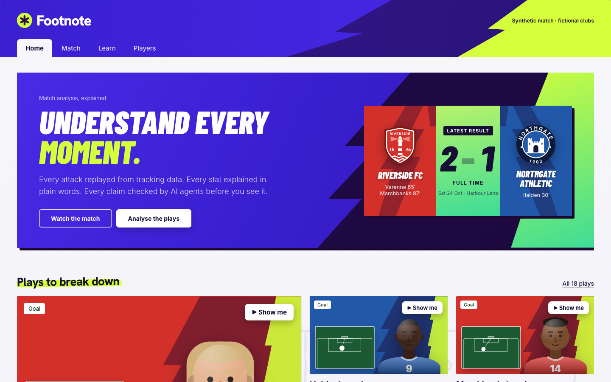
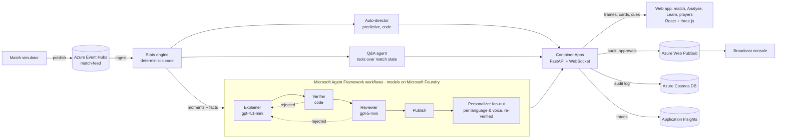

# Footnote

*Take a second look at every moment.*

[](https://github.com/hansonq888/live-cards/actions/workflows/ci.yml)


**Football analytics that explains itself.** The league already publishes xG, pass maps and
dozens of advanced stats, and most fans can't read them. Footnote turns a match into moments you
can *understand*: ask why a goal happened and watch it replayed touch by touch on a tactics
board, with the space each pass opened; follow any player and see every number change, with its
reason; learn what each stat means from the match in front of you. **Numbers come from code,
words from AI agents, and nothing reaches the screen until two independent checks pass.**


**[Live demo](https://livecards.mangorock-d6a7d3f2.northcentralus.azurecontainerapps.io/)** ·
**[Show me a goal](https://livecards.mangorock-d6a7d3f2.northcentralus.azurecontainerapps.io/?page=analyse&showme=e-1666)** ·
**[Broadcast console](https://livecards.mangorock-d6a7d3f2.northcentralus.azurecontainerapps.io/?view=console)** ·
[Evaluation](docs/evaluation.md) · [Load test](docs/load-test.md) · [Cost](docs/cost.md) · [Architecture and deployment](docs/deployment.md) · [Design decisions](docs/decisions.md)

> Built for the Microsoft × Premier League *Inside the Game* hackathon, October 2026.
> **All data is synthetic:** the clubs (Riverside FC, Northgate Athletic), the players, the
> venue and every event come from our own simulator.

## Try it in 60 seconds

1. **[Show me a goal](https://livecards.mangorock-d6a7d3f2.northcentralus.azurecontainerapps.io/?page=analyse&showme=e-1666).** The 65' equaliser replays on the tactics
   board, touch by touch, with the space each pass opened and a checked one-line story.
2. **Ask the match.** On the same page, open *Ask the match* (bottom right) and ask *"Who has been
   the fastest player?"* or *"How was Halden's goal built?"* Answers come with evidence; play
   answers have a ▶ Show me button.
3. **Follow a player.** Click any player on the pitch: their card, heatmap and numbers update as
   they play. Tap *◐ Colour by* to colour all 22 players by a stat.
4. **Watch the agents work.** Open the *Agents* tab under the video, press play, then *Plant a lie*:
   the row shows the lie rejected by the code verifier, rewritten, and aired clean.
5. **[Learn xG](https://livecards.mangorock-d6a7d3f2.northcentralus.azurecontainerapps.io/?page=learn#xg).** Click anywhere on the pitch and the engine scores the shot.

---

## What it does

| | |
|---|---|
| **Show me** | Ask *"How was Varenne's goal built?"* (or tap ▶ Show me on any play) and the move replays on a tactics board: each touch drawn and held, the space each team controls shaded, *"+28 m² of the final third"* popping up as a pass opens the pitch, then a verified one-line story. |
| **Ask the match** | Plain-language questions answered by a tool-calling agent over the match data, with evidence. Questions about the future, other seasons, money or opinions are refused in code before any model runs. |
| **Follow anyone, live** | Click a player: their card, heatmap and key numbers update as they play, and every rating change says why (*"Rating up to 6.4: passed under pressure and won a tackle"*). Otherwise an auto-director keeps the ring on the ball, and jumps to the striker *before* a cross lands. |
| **Colour by any stat** | One tap colours all 22 players by rating, pace, passing, threat, defending or work rate, cool to hot, live. Hover for the number. |
| **Learn the numbers** | Each stat as a short lesson built from this match: what it means, a diagram, a real example to replay, and the formula. The xG lesson lets you click anywhere on a pitch and the engine scores the shot. |
| **Every play as a story** | A scroll-driven breakdown per play: a lesson card per touch, the space it created, and a *"your call"* guess at the shot's xG before it's revealed. |
| **Two different experiences** | Casual or analyst wording, five languages (English, Spanish, French, Portuguese, Arabic), and a neutral or home/away fan voice. Every variant is re-verified in its language. |
| **Watch the agents work** | An Agents tab shows every moment going through the pipeline live: Explainer → code Verifier → Reviewer → aired, with timings, any rejection and its reason, the rewrite, and what the AI cost so far. A *Plant a lie* button shows the checks catching one. |
| **Built for a broadcaster** | A console with kill switches, an insight allowlist, human approval, and a permanent audit log of every line aired or blocked. Every on-screen element is also a timed, machine-readable overlay cue ([JSON Schema](docs/overlay-cue.schema.json)). |

| Show me: a goal replayed on the tactics board | Agents, live: a planted lie caught and rewritten |
|---|---|
|  |  |
| **Following a player, every ring coloured by work rate** | **Every play as a story** |
|  |  |
| **Squads, with the starting XI** | **Learn: click the pitch, the engine scores the shot** |
|  |  |
| **Home** | **Broadcast console** |
|  |  |

## The brief's pipeline, end to end

| Stage | How Footnote does it | Where |
|---|---|---|
| **Ingest** | A 90-minute simulation: positions at 10 fps (54,000 frames), plus passes, shots, tackles, interceptions, pressures, fouls, cards, substitutions. It's published to **Azure Event Hubs** and ingested back by the engine. | [`sim/`](backend/livecards/sim), [`feed.py`](backend/livecards/feed.py) |
| **Interpret** | Deterministic code turns events and tracking into stats, a 0–10 rating, five attributes, sprints and alerts, momentum, control vs. chaos, and *moments* scored for importance. **No model ever computes a number.** | [`engine/`](backend/livecards/engine) |
| **Explain** | Agents write *why* a moment matters: the Explainer, a code Verifier, a gpt-5-mini Reviewer, Q&A with tools, and play breakdowns reconstructed from events with the space each touch created. | [`agents/`](backend/livecards/agents) |
| **Render** | A three.js broadcast and a tactics board: ring, cards, stat rings, goal graphics, Show me replays. The same content is emitted as timed overlay cues. | [`web/`](web/src), [`cues.py`](backend/livecards/server/cues.py) |
| **Personalize** | Casual or analyst, five languages, home/away/neutral voice, and your own rating model. Every variant is re-verified in its language. | [`personalizer.py`](backend/livecards/agents/personalizer.py), [`i18n.ts`](web/src/i18n.ts) |

## Architecture



| Microsoft technology | Used for |
|---|---|
| **Microsoft Foundry** | Hosts gpt-4.1-mini (Explainer, Personalizer, Q&A) and gpt-5-mini (Reviewer); built-in **evaluators** score the agents ([results](docs/evaluation.md)) |
| **Microsoft Agent Framework** | Agents and workflows: explain → verify → review → rewrite → publish with conditional edges; Personalizer **fan-out/fan-in**; tool-calling Q&A; OpenTelemetry spans; `FoundryEvals` |
| **Azure Container Apps** + Container Registry | Hosts the API, the WebSocket streams and the web app |
| **Azure Event Hubs** | The match feed: the simulator publishes, the engine ingests |
| **Azure Web PubSub** | Fans audit entries, approval requests and control changes out to every connected console |
| **Azure Cosmos DB** (serverless) | The audit log: every line aired, blocked or held, with its evidence |
| **Application Insights** | Traces each moment through each agent, model call, Event Hubs read, Cosmos write and Web PubSub send |

`/api/status` on the live site reports which backend is live for each concern. Every Azure
service has a local fallback (in-process feed, SQLite, app socket), so the app runs anywhere.
Identity is keyless in code: a service principal with narrowly scoped roles. See
[docs/deployment.md](docs/deployment.md) for why it isn't a managed identity.

## Vision layer: no tracking system needed

Footnote runs on position data. To show it could also run from a broadcast picture, a
pretrained YOLO model (no training) finds players and splits teams by shirt colour, and a
pitch homography places them in metres. We measured it against the simulator's ground truth on
54 rendered frames ([docs/vision.md](docs/vision.md)):

| | Players found | Team right | Position error (median) |
|---|---|---|---|
| Clean feed | 95.8% | 99.9% | 0.18 m |
| Low-bitrate stream + calibration error | 87.7% | 85.5% | 0.26 m |

Synthetic frames are easier than real footage, and player identity isn't solved here.

## Why the AI can be trusted

1. **Models never produce numbers.** Every statistic, rating and xG value comes from deterministic,
   unit-tested code. Agents only write the words around numbers they are handed.
2. **Two independent checks before anything airs.** A code verifier matches every number, name and
   superlative against the evidence (in five languages, in under a millisecond); a separate
   reasoning model rejects invented events the code can't judge.
3. **Failures recover, they don't leak.** A rejected line is rewritten once with the reason; if it
   still fails, the engine's code-checked stats line airs instead. Measured over a full match:
   25 of 135 lines were fixed by a rewrite, 13 fell back, **0 unverified lines aired**.
4. **Everything is auditable.** Every line aired, blocked or held is logged with its evidence
   (Cosmos DB), and a broadcaster console has kill switches and human approval.

## The agents

| Agent | Job | Model | Fallback when it fails |
|---|---|---|---|
| **Auto-director** | Who the ring follows and why, ten times a second: whoever has the ball (99.9% of possession frames), and the receiver of a cross or through ball before it lands | code (by design: a plain function beats an agent here) | nearest player to the ball |
| **Explainer** | One short line per moment, using only the facts it's given | gpt-4.1-mini | the engine's stats line |
| **Verifier** | Every number (digits, decimals, scores, number words, ordinals, percentages; 5 languages), every player name, every superlative must be in the evidence | code | blocks; the Explainer rewrites once with the reason |
| **Reviewer** | Rejects claimed events or details the facts don't support ("a header", "an assist" that didn't happen) | gpt-5-mini, low reasoning effort | **fails closed** after one retry |
| **Personalizer** | The verified line for each fan profile in parallel (audience × language × voice), each re-verified in its language | gpt-4.1-mini | the verified English line |
| **Q&A agent** | Answers fan questions with ten tools over the live match (cards, rating ledger, moments, team state, leaders, plays, play breakdowns with space control, stat definitions, comparisons, time windows); its play answers open in Show me | gpt-4.1-mini + tools | *"I can't verify that from the match data."* |
| **Red team** | Corrupts the Explainer's first draft on demand, to show the checks working on air | wraps the Explainer | not applicable |

Lines appear in two phases: the engine's stats line airs instantly (it's code, verified in
under a millisecond), then the AI line replaces it only after it passes both checks. The
screen never waits, and nothing unchecked airs.

## Trust, measured

From [docs/evaluation.md](docs/evaluation.md): 330 lines built from real match moments in
English, Spanish and French, with lies planted in 275.

| Case | Code verifier | Reviewer | Both (what airs) |
|---|---|---|---|
| Correct lines allowed | 100% | 91–95% | 91–95% |
| Changed number blocked | 85% | 100% | **100%** |
| Wrong number in words | 100% | 100% | **100%** |
| Wrong player | 100% | 100% | **100%** |
| Unsupported superlative | 100% | 100% | **100%** |
| Invented event (all numbers correct) | 0% | 100% | **100%** |

The two layers cover each other: code can't judge an invented header; a model can miss a
digit. Microsoft Foundry's own evaluators rate the **raw** Explainer 14/15 on groundedness (the
reason nothing raw airs) and the Q&A agent 5/5 on intent resolution, task adherence and
tool-call accuracy. The test suite (196 tests) includes a whole-match mutation test: change any
one number in any engine-written line and the verifier must block it.

**Ask, measured** ([docs/qa-evaluation.md](docs/qa-evaluation.md)): 42 analyst and fan questions run through the Q&A agent at full time. The agent has ten tools over the live engine: cards, rating ledger, moments, team state, leaders, plays, play breakdowns with space control, stat definitions, player comparisons and time windows.
- 91–94% of answerable questions answered, with the right tool 97% of the time
- 100% of out-of-scope questions refused (future, other seasons, money, opinions); a code guard catches these before any model runs
- Every answer passes the same verifier and reviewer as on-screen lines

## The numbers, and where they come from

**Numbers come from code, words come from agents.** Each formula lives in
[`engine/`](backend/livecards/engine) and is unit-tested. We label what's standard and what's ours:

| Standard in football analytics | Our own design |
|---|---|
| xG concept (ours is a simple logistic on distance and goal-mouth angle, not trained on real shots) | The 0–10 live rating and its event weights |
| Pass completion, tackles, interceptions, pressures, distance, top speed | The five attributes (Pace, Passing, Threat, Defending, Engine) and how they combine metrics |
| Sprint ≥ 25.2 km/h and high-intensity run ≥ 19.8 km/h thresholds | Pass difficulty, momentum, control vs. chaos |

**Live rating (0–10):** starts at 6.0 and moves with each event, capped at 3.0 and 10.0. Every
change is in an auditable ledger with its event id. Event weights: goal +1.0, assist +0.6,
chance created +0.15, shot on target +0.1, tackle or interception won +0.1, pass completed under
pressure +0.03, turnover in own half −0.15, foul −0.05, yellow card −0.3.

**Attributes (1–99):** `base + clamp(round(8 × Σ wᵢ·zᵢ), −20, +20)`, where `zᵢ` compares a
metric with the player's role average. Values are shrunk toward the average early in a match (a
30-minute prior), so one tackle can't swing a card. Role averages are measured on 8 simulated
matches. Pace can only rise during a match (tiredness shows in Engine).

| Attribute | Metrics (weight) |
|---|---|
| Pace | top speed (0.6), sprints (0.4) |
| Passing | completion % (0.4), forward passes (0.3), average pass difficulty (0.3) |
| Threat | shots (0.3), xG (0.4), chances created (0.3) |
| Defending | tackles won (0.35), interceptions (0.35), pressures that won the ball (0.3) |
| Engine | distance per minute (0.6), high-intensity runs (0.4) |

**Pass difficulty (1–10):** `1 + min(4, distance/10) + min(2, progress/15) + 1.5 under pressure
+ 1.0 into the final third + 0.5 for a cross or through ball`.
**xG:** `logistic(−1.1 + 1.6·angle − 0.075·distance)`. The penalty spot is 0.29.

**Upgrades:** the rating rises 0.5+ or an attribute rises 3+ (net) within 10 minutes; once per
rise. **Alerts:** sprint over 32 km/h, fastest sprint of the match, three notable actions in a
row, every 2 km covered.

Every stat is defined once in a **stat registry** ([`engine/registry.py`](backend/livecards/engine/registry.py), served at `/api/stats`): meaning, formula, the settings the engine actually uses, and fan wording in five languages. Adding a stat there puts it on the Learn page and in breakdowns; see [docs/adding-a-stat.md](docs/adding-a-stat.md).

Disagree with any of it? **Your model** (Analyse → ⚙ Settings → Your model) lets you change the weights and see
both ratings side by side.

## Measured

Only numbers we measured (details in [docs/decisions.md](docs/decisions.md)):

| | |
|---|---|
| Stats line on screen after a goal | **0.3 ms** to verify; airs with the moment |
| AI line on screen after a goal (cloud) | **3.2–3.3 s**, through Explainer, Verifier and Reviewer; up to ~6 s at busy moments |
| Explainer / Reviewer model call | 0.8–2.3 s / 1.9–3.2 s |
| Full 90-minute simulation | ~1.5 s for 54,000 frames + ~2,300 events |
| Match through Event Hubs | 1,093 messages, 12.4 MB compressed; published in 8.5 s, ingested in 12.9 s |
| Planted lies aired | **0 of 275** |
| Concurrent live viewers, one server process | **200** in real time (p95 frame gap 103 ms, 66% of one core); 400 saturates it ([load test](docs/load-test.md)) |
| Ring on the player with the ball | **99.9%** of frames once they've had it 1.3 s (43% before the auto-director was retuned) |
| Ask: answerable questions answered / right tool / out-of-scope refused | 91% / 97% / 100% ([evaluation](docs/qa-evaluation.md)) |
| AI cost of a full match | **~$0.15** for 135 explained moments: 496 model calls, 228k tokens; 122 AI lines aired, 25 fixed by a rewrite, 13 fell back to the stats line ([cost](docs/cost.md)) |
| Model calls saved for every further viewer | **98%**: viewers 2 and 3 of the same 15 minutes made 4 and 0 model calls vs 81 for the first, reusing verified lines and translations ([cache](docs/cache.md)) |

## Run it

```bash
# backend (Python 3.12, uv)
cd backend && uv sync --extra agents --extra azure
uv run pytest -q                                   # 196 tests
uv run uvicorn livecards.server.app:app --port 8010

# web (Node 22)
cd web && npm install && npm run dev -- --port 5180
# open http://localhost:5180  (or ?page=analyse&showme=e-1666 for the hero goal)
```

Without Azure configured, everything still runs: templates instead of AI lines, a local
feed, SQLite, and the app socket. To use Foundry, follow [docs/azure-setup.md](docs/azure-setup.md)
and fill in `backend/.env`. Deploy with `deploy/redeploy.sh <tag>`. Other scripts:
`scripts/evaluate.py` (safety + Foundry evals), `scripts/calibrate_baselines.py`,
`livecards replay --seed 7 --from 64 --to 68` (terminal replay).

## Limitations, honestly

- **Synthetic data:** the role averages, xG and the storylines (a planted sprint-and-goal, a fading
  midfielder, a late winner) come from our simulator, and every seed ends 2–1 by design. In
  production the engine would read a real tracking and event feed instead.
- **The rating weights come from the brief, not from data.** Routine passes under pressure add
  up (+0.87 for 29 of them), which an analyst will spot. That's why "Your model" exists.
- **The verifier matches numbers, not units:** a wrong number that happens to equal another fact
  can pass the code check (8 of 55 in the evaluation); the reviewer caught all of them.
- **One replica:** the console's control plane and viewer sessions live in memory. One process
  handles 200 live viewers; scaling out would move that state to Redis or the Cosmos change feed.
- **Pass difficulty, momentum and control vs. chaos are our own formulas,** not industry standards.

## Repo layout

```
backend/livecards/
  sim/        simulator, fictional roster, planted storylines
  engine/     stats, rating ledger, attributes, moments, build-ups, your-model specs
  agents/     explainer, verifier, reviewer, personalizer, Q&A, director, red team, pipeline
  server/     FastAPI app, live sessions, console control plane, audit log, cues, Web PubSub
  feed.py     Event Hubs publish/ingest      telemetry.py   Application Insights
backend/tests/  196 tests       backend/scripts/  evaluate, calibrate, record GIF, screenshots
web/src/    React + three.js: viewer, tactics board, Show me, Learn, story pages, players, console, i18n
vision/     YOLO vision layer, capture with ground truth, evaluation
docs/       evaluation, vision, deployment, decisions, pitch, cue schema, media
```

Clubs, players, venue and data are fictional. No league data, logos or branding are used.
