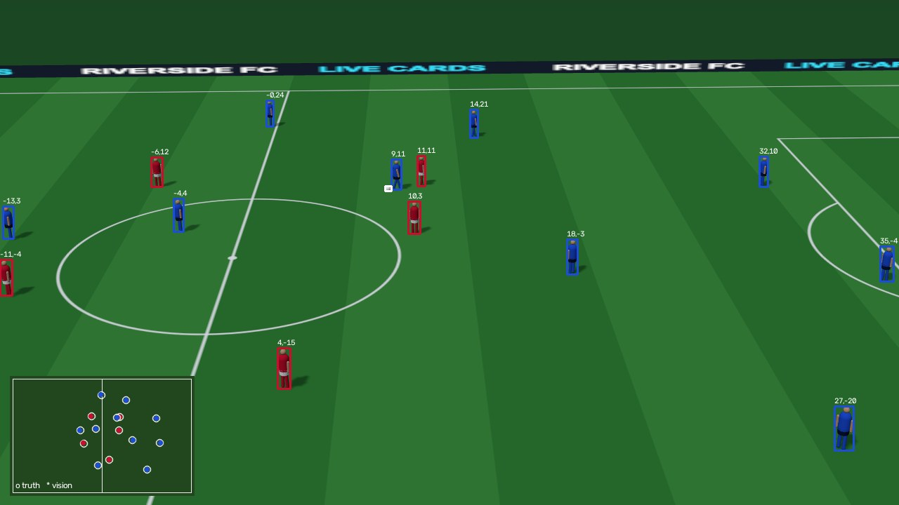

# Vision layer: players from the broadcast picture

**Question:** Live Cards runs on position data. Could a match with no tracking system feed it
from the broadcast picture alone?

**Method** ([`vision/`](../vision)): a pretrained YOLOv8s (no training or fine-tuning) finds
people and the ball. Shirt colour splits the teams and the goalkeepers. A ground-plane
homography turns each player's feet into pitch metres, in the same coordinates the simulator
and stats engine use.

**Measured against ground truth:** our renderer knows exactly where every player is.
[`vision/capture.py`](../vision/capture.py) records 54 frames across the match from the viewer
in capture mode (no ring or graphics), each with the true position of every player and the
ball, in pitch metres and in pixels. [`vision/evaluate.py`](../vision/evaluate.py) runs the
layer on each frame and matches detections to the players really in shot (Hungarian matching
on foot position, gated by player size).

| 54 frames, 739 players in shot | Players found | False detections | Team right | Position error, median / p90 | Ball found |
|---|---|---|---|---|---|
| Clean feed, calibrated camera | **95.8%** | 3.1% | **99.9%** | **0.18 m / 0.35 m** | 37 / 54 |
| Clean feed, calibrated from pitch markings in shot | 95.8% | 3.1% | 99.9% | 0.18 m / 0.35 m | 37 / 54 |
| Low-bitrate stream (half resolution, pan blur, noise, JPEG q35) + 2 px calibration error | **87.7%** | 3.7% | **85.5%** | **0.26 m / 0.54 m** | 7 / 54 |

About 0.11–0.13 s per 1280×720 frame on a laptop CPU (Apple silicon, no GPU). Exact numbers
are in [`docs/vision/`](vision).



**What we learned**
- The detector has never seen our low-poly players, yet finds 96% of them, with
  only 3% false detections.
- **Calibration needs the centre circle.** In most broadcast shots the only line intersections
  in view lie on the halfway line, which can't fix a homography. Our first version, which used
  intersections only, put some players hundreds of metres off. Adding points around the centre
  circle (as an ellipse fitter would find them) fixed every frame.
- **Stream quality hurts the team split more than detection.** Compression shifts shirt hues;
  a tracker voting across frames would recover most of this.
- **The ball is the weak point.** At broadcast distance it's a few pixels wide and vanishes in
  a compressed stream (7 of 54). Production systems use a dedicated ball detector.

**Limits.** These are synthetic frames, simpler than real footage: no crowd, no camera cuts or
zoom changes, no motion blur from real camera movement. Player identity (who is #9?) isn't solved
here; that needs tracking across frames plus shirt numbers. In the "markings" mode the marking
points are located exactly from the camera model (our stand-in for a line and ellipse finder);
the stream row adds 2 px of error to them. The next step is a real clip, filmed by us, through the
same code.

## Real footage: the Vision view

`?view=vision` plays a real clip, 14 s of drone footage of an indoor 7-a-side match from
[Pexels](https://www.pexels.com) (free licence; no club, league or sponsor branding). The ring
follows a player chosen by click.
[`vision/track_clip.py`](../vision/track_clip.py) processed it offline:
- the same pretrained YOLO finds people and the ball
- ByteTrack keeps each player's identity from frame to frame
- shirt colour decides the team by majority vote over each track, so it doesn't flicker
- anyone not standing on the grass (bench, spectators) is dropped

The page draws the tracks in sync with the video.

On this clip (359 frames): about 15 players tracked per frame, split 20 white and 15 navy tracks
(2 others: keepers or the referee), with the ball found in 23% of frames. The camera moves, so
the tracker sometimes loses a player and picks them up under a new ID (37 tracks for about 22
people). The view hands the ring to the nearest player of the same team when that happens. We
have no ground truth for this clip, so these are counts, not accuracy. The accuracy numbers
are the synthetic ones above.

Reproduce (with the app running locally):

```bash
cd vision && uv sync
uv run python capture.py --base http://localhost:5180 --out data/synthetic
uv run python evaluate.py --calib camera
uv run python evaluate.py --calib markings --calib-noise 2 --degrade
uv run --with pytest pytest -q tests
uv run python track_clip.py ../web/public/vision/clip.mp4 ../web/public/vision/tracks.json
```
